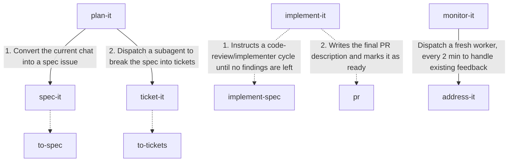

# ship-it

You bring the idea. Ship-it helps your coding agent write the spec, break it into tickets, implement the changes, and work through PR feedback. You review and merge.

Ship-it combines orchestration skills with utilities that each handle one responsibility. Use them together or individually to build your workflow.

Some of the utility skills are simple wrappers extending [Matt Pocock's skills](https://github.com/mattpocock/skills). Thanks to Matt and all the people who helped those skills evolve.

## Usage

Start by discussing your idea or feature with your agent, and when you are ready, follow one of the workflows below.

### Manual workflow

1. On the same session as the discussion, invoke `spec-it` to turn it into a spec under a GitHub issue.
2. Invoke `ticket-it #<gh-issue-id>` to create a sub-issue for each ticket in the spec.
3. Invoke `implement-it #<gh-issue-id>` to implement the spec with a draft PR, then mark it ready with `status/ready-for-review` after both review axes and required checks pass.
4. When PR feedback appears, invoke `address-it #<gh-issue-id>` to evaluate the feedback, resolve merge conflicts with the base branch, apply justified fixes, and push them.

> [!Note]
> The `address-it` skill does not establish merge readiness. The PR will either be labeled with `status/ready-for-review`, or `status/blocked` when work cannot proceed. Invoke `monitor-it` for scheduled monitoring and its merge readiness gate.

### Monitored workflow

1. On the same session as the discussion, invoke `plan-it`, and wait for the GitHub issue to be created.
2. On a new session, invoke `implement-it #<gh-issue-id>`, and wait for the implementation to finish.
3. On a new session, invoke `monitor-it #<gh-issue-id>` to automatically monitor the PR for feedback review and apply justified fixes or hand it off for human review.

> [!Tip]
> Review the implementation result before starting monitoring. The skills recover implementation context from the report and PR, so implementation and monitoring can each run in a new session.

> [!Note]
> Monitoring leaves the PR labeled `status/ready-for-review` for human review, `status/ready-for-merge` after its readiness gates pass, or `status/blocked` when work cannot proceed.

---

> [!Important]
> When invoking the `plan-it` and `spec-it` skills, make sure they run on same session where the idea/feature discussion took place, all other skills can and should run on new sessions. See [Quality and maintainability](#quality-and-maintainability) section for more details.

> [!Note]
> None of these workflows creates GitHub issues without user approval or merges PRs. When a PR is ready to merge, a human merges it.

## Dependencies

- Matt Pocock's skills, installed globally or in your project
  
```sh
npx skills@latest add -g mattpocock/skills
```

We recommend installing these skills globally. To install them in your project, omit `-g`.

- GitHub CLI (`gh`) installed. `setup-ship-it` selects existing stored credentials or isolated machine-user credentials.

  ```sh
  brew install gh
  ```
  
  See [GitHub CLI installation instructions](https://cli.github.com/) for platforms other than macOS.
  
- An agent tool that supports subagents and scheduling.

## Setup

- Install the `goncalvesjoao/ship-it` skills
  
```sh
npx skills@latest add -g goncalvesjoao/ship-it
```

We recommend installing these skills globally. To install them in your project, omit `-g`.

- After installation, invoke `setup-ship-it` on your project before invoking any other skill.

## The skills

| Skill | Type | Description |
| --- | --- | --- |
| [setup-ship-it](skills/setup-ship-it/SKILL.md) | Setup | Configures repository policy and optional machine-user isolation, reusing Matt Pocock's setup. |
| [plan-it](skills/plan-it/SKILL.md) | Orchestration | Runs `spec-it` in the parent chat, then delegates `ticket-it` to a fresh subagent, relaying its questions and approvals through the parent chat. |
| [spec-it](skills/spec-it/SKILL.md) | Utility | Invokes Matt Pocock's `to-spec` to publish a GitHub spec issue, adds `spec` if missing, and adds `status/todo` only when no `status/` label exists. |
| [ticket-it](skills/ticket-it/SKILL.md) | Utility | Extends Matt Pocock's `to-tickets` to publish every ticket as a GitHub sub-issue of the spec's parent issue with the `ticket` label, adding `status/todo` only when no `status/` label exists. |
| [implement-it](skills/implement-it/SKILL.md) | Utility | Replaces GitHub spec and active ticket status labels with `status/in-progress` and extends Matt Pocock's `implement-spec` with repeated `code-review` and implementer fix rounds until both review axes report zero findings and required checks pass. Uses a dedicated integration worktree per spec, with exclusive session ownership. Creates an implementation report under `docs/implementations/<spec-gh-issue-id>.md`, opens a draft PR after the first ticket merge, and marks it ready after the gate passes. |
| [monitor-it](skills/monitor-it/SKILL.md) | Orchestration | Monitors Copilot reviews every two minutes, invokes `address-it`, and updates the PR's status. Hands off for human review when Copilot is unused or not configured for the PR. |
| [address-it](skills/address-it/SKILL.md) | Utility | Evaluates existing human or Copilot PR feedback and checks for merge conflicts, delegates fixes and conflict resolution, validates and pushes them, and replies with evidence. Runs the same single pass for any caller; `monitor-it` keeps scheduling in the main chat and delegates monitoring decisions to a fresh worker. |

### How they relate to each other

- Solid arrows show local skill calls, worker delegation, and outcomes; dashed arrows invoke Matt Pocock's skills.
- Numbered stages run in order after the previous stage succeeds.



### Their dependencies

When installing skills individually, install their dependencies too, the skills CLI does not automatically install dependencies, including those listed in `metadata.dependency`.

| Skill | Required skills from this repository | Required skills from `mattpocock/skills` |
| --- | --- | --- |
| `setup-ship-it` | None | `setup-matt-pocock-skills` |
| `plan-it` | `spec-it`, `ticket-it` | `to-spec`, `to-tickets` |
| `spec-it` | None | `to-spec` |
| `ticket-it` | None | `to-tickets` |
| `implement-it` | None | `implement-spec`, `code-review`, `pr` |
| `monitor-it` | `address-it` | None |
| `address-it` | None | None |

For example, install `monitor-it` with its resolver:

```sh
npx skills@latest add goncalvesjoao/ship-it --skill monitor-it --skill address-it
```

Use `-g` to install both globally.

## Quality and maintainability

Regardless of the implementation being done by an agent or a human, the tunel vision required to do it naturally blinds the implementor of the impact those changes can have on the ability to add or update features in the future.

This is why Pull Request reviews are so important and why some people are so picky about them, if productivity slows down or bugs start to show up, part of the blame goes to the implementor but it's the reviewer's responsability that, that doesn't happen in the first place.

Agents can do a very good job as long as their context stays within the *smart zone*, unfortunatelly the implementation of a feature is rarelly a one-time-shot and requires back and forth iterations, since we can never guess how many iterations are required, there is a chance the context can grow past that zone and start producing code with less quality, which in turn might cause more iterations and the problem compounds.

To mitigate this, all skills (apart from `plan-it` and `spec-it`) are setup in such a way that, if invoked on a clean session, they only load the minimum necessary context for their normal operation, below is a table that shows what each skill needs and how it loads that context.

| Skill | Required context | How the skill has access to it |
| --- | --- | --- |
| `plan-it`, `spec-it` | Idea/feature discussion | Skill must run on the same chat where the discussion took place |
| `ticket-it` | Spec details | User invokes it with the spec's GitHub issue ID and the skill loads its body into context |
| `implement-it` | Spec and tickets details | User invokes it with the spec's GitHub issue ID, the skill loads into context, its body and body of the GitHub sub-issues for the tickets of the spec |
| `monitor-it`, `address-it` | Implementation and PR details | User invokes it with the spec's GitHub issue ID, the skill loads into context the implementation report created by `implement-it` and the PR body created by `implement-it` |
